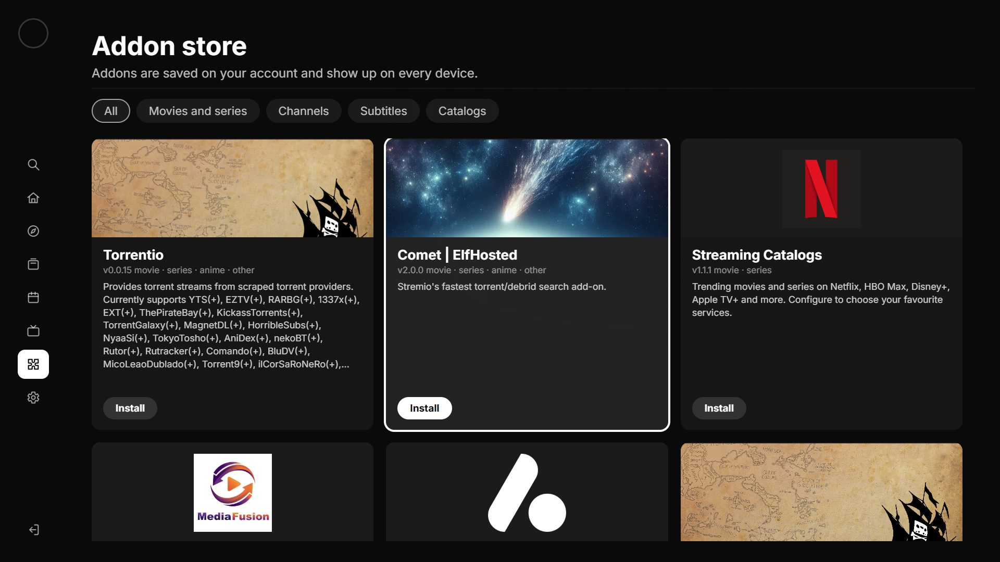

# StremCompat for Android TV

  

  
  
  
  

StremCompat brings your **Stremio or Nuvio** account and addons to Android TV and Google TV boxes and TVs, with an interface made for the remote. It is an independent, unofficial project, not affiliated with or endorsed by Stremio, Nuvio or Google, and it plays only what your own addons provide.

> **Test versions.** Please report problems in [Discussions](https://github.com/StremCompat/android-tv/discussions).

## Two versions

| | **StremCompat** | **StremCompat Native** |
|---|---|---|
| Status | The more tested one | Newer, **faster** |
| How it is made | The interface as a web page in a WebView | The native app in C, drawn with OpenGL ES (SDL2) |
| Video | Android's own player (ExoPlayer) | The same |
| Package | `io.github.alexesmm.stremcompat` | `io.github.alexesmm.stremcompat.native` |

Both can be installed together. On its first start the native version brings your account, library and settings from the web one.

## Features

The same app as on LG ([full list](https://github.com/StremCompat/webos#features)):

- Stremio or Nuvio account with QR or email sign-in, Nuvio profiles with PINs, and Nuvio Collections as in Nuvio's apps.
- Home, Discover, Search, Library, Continue Watching, new episodes and, for Stremio accounts, a Calendar.
- Live channels from addons (such as NexoTV) and M3U lists, with what is on now and search.
- An addon store, adding addons and lists by address, typed or pasted from your phone, and organizing the rows of Home.
- Best source, source filters, subtitles and audio remembered per title, Skip intro and the next episode.
- **Video with ExoPlayer:** MKV, HEVC and surround sound play as in the official apps.
- **Torrents** play on the device itself, through a torrent engine inside the app. Debrid and direct links work too.
- Eleven languages.

## Screenshots

The interface is the same as on LG ([more screenshots](https://github.com/StremCompat/webos#screenshots)).

<table>
  <tr>
    <td></td>
    <td></td>
  </tr>
  <tr>
    <td></td>
    <td></td>
  </tr>
</table>

## Installation

1. Download the `.apk` of the version you want from [Releases](https://github.com/StremCompat/android-tv/releases):
   - `StremCompat-v…-AndroidTV.apk` (web version);
   - `StremCompat-Native-v…-AndroidTV.apk` (native version).
2. On the TV, install the **Downloader** app (by AFTVnews) from the Play Store, and allow it to install unknown apps (Settings > Device Preferences > Security & restrictions > Unknown sources).
3. In Downloader, type the address of the `.apk` from the release page and install it.

Or, from a computer: `adb install StremCompat-…-AndroidTV.apk`.

**Requirements:** Android TV or Google TV 7.0 or newer, on an ARM device (nearly every TV box and TV). The x86 emulator is not supported.

## Troubleshooting

- **The app shows "Starting…" for a long time on its first open:** it unpacks its local server once; later starts are quick.
- **A source does not play:** try another source; ExoPlayer plays most formats, but some addons' links expire quickly.
- **The QR code to paste an address from the phone does not open:** the phone must be on the same Wi-Fi; type the address with the app's keyboard instead.

## Feedback and support

Questions in [Discussions](https://github.com/StremCompat/android-tv/discussions), reproducible bugs in [Issues](https://github.com/StremCompat/android-tv/issues). Source code: [StremCompat/stremcompat](https://github.com/StremCompat/stremcompat) and [StremCompat/native](https://github.com/StremCompat/native).

If StremCompat has been useful to you, you can [buy me a coffee ☕](https://buymeacoffee.com/Alexesmm), entirely optional.

StremCompat is licensed under [GPL-3.0](LICENSE). Stremio, Nuvio and Google are trademarks of their owners.
