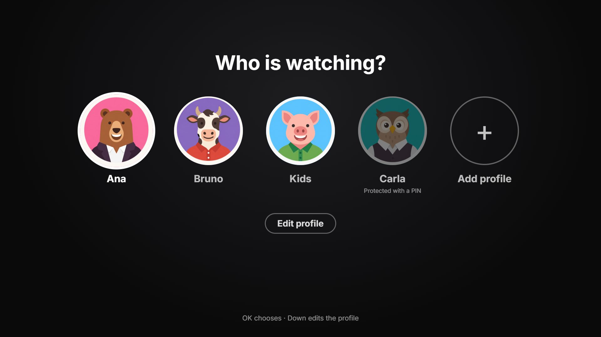
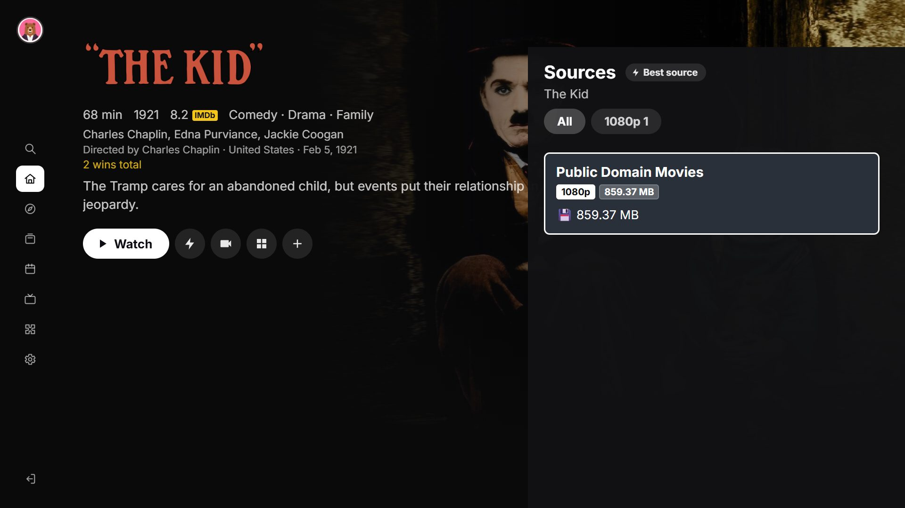

# StremCompat para Android TV

  

  
  
  
  
  

<a href="README.md">English</a> · <b>Português</b>

O StremCompat leva sua conta e seus addons do **Stremio ou do Nuvio** para TVs e TV boxes com Android TV e Google TV, com uma interface feita para o controle remoto. É um projeto independente e não oficial, sem ligação com o Stremio, o Nuvio ou o Google, e toca apenas o que os seus addons oferecem.

> **Versões de teste.** Relate problemas em [Discussions](https://github.com/StremCompat/android-tv/discussions).

## Duas versões

| | **StremCompat** | **StremCompat Native** |
|---|---|---|
| Situação | **Recomendada** | **Beta**, ainda não estável: mais rápida, mas pode ter falhas |
| Como é feita | A interface como página numa WebView | O app nativo em C, desenhado com OpenGL ES (SDL2) |
| Vídeo | O player do próprio Android (ExoPlayer) | O mesmo |
| Pacote | `io.github.alexesmm.stremcompat` | `io.github.alexesmm.stremcompat.native` |

As duas podem ser instaladas juntas. Na primeira vez que abre, a versão Native traz sua conta, biblioteca e ajustes da versão web.

Também há um **app para celulares Android** (beta), com a mesma conta e os mesmos addons, publicado neste repositório como `StremCompat-Phone-v…-beta-Android.apk`.

## Recursos

O mesmo app da LG ([lista completa](https://github.com/StremCompat/webos/blob/main/README.pt.md#recursos)):

- Conta Stremio ou Nuvio com QR ou e-mail, perfis do Nuvio com PIN e Coleções do Nuvio como nos apps do Nuvio.
- Início, Descobrir, Busca, Biblioteca, Continuar assistindo, episódios novos e próximos e, para contas Stremio, um Calendário.
- Canais ao vivo de addons (como o NexoTV) e de listas M3U, com programação atual e busca.
- Loja de addons, adicionar addons e listas pelo endereço (digitado ou colado pelo celular) e organizar as fileiras do Início.
- Melhor fonte, filtros de fontes, legendas e áudio lembrados por série, pular abertura e próximo episódio.
- **Vídeo com ExoPlayer:** MKV, HEVC e som surround tocam como nos apps oficiais.
- **Torrents** tocam no próprio aparelho, por um motor de torrent dentro do app. Debrid e links diretos também funcionam.
- O que você está assistindo aparece na fileira "Continuar assistindo" da tela inicial do Google TV.
- Onze idiomas.

## Capturas de tela

Capturadas da interface real em 1920x1080, com uma conta de demonstração, os addons oficiais do Stremio e uma lista pública de canais. A interface é a mesma na LG, na Samsung e no Android TV.

<table>
  <tr>
    <td width="50%" valign="top"> <b>Início</b> Seus catálogos em fileiras, com o título em foco em destaque no topo.</td>
    <td width="50%" valign="top"> <b>Quem está assistindo</b> Perfis do Nuvio, com os protegidos por PIN marcados.</td>
  </tr>
  <tr>
    <td width="50%" valign="top"> <b>Página da série</b> Detalhes, elenco, temporadas e episódios com datas de estreia.</td>
    <td width="50%" valign="top"> <b>Fontes</b> Todas as fontes que seus addons encontram; ou a Melhor fonte num botão.</td>
  </tr>
  <tr>
    <td width="50%" valign="top"> <b>Canais ao vivo</b> Categorias à esquerda, canais e programação atual à direita.</td>
    <td width="50%" valign="top"> <b>Loja de addons</b> Addons da comunidade por popularidade, com imagem e descrição.</td>
  </tr>
</table>

## Instalação

1. Baixe o `.apk` da versão que você quer em [Releases](https://github.com/StremCompat/android-tv/releases):
   - `StremCompat-v…-AndroidTV.apk` (versão web);
   - `StremCompat-Native-v…-AndroidTV.apk` (versão Native).
2. Na TV, instale o app **Downloader** (da AFTVnews) pela Play Store e permita que ele instale apps desconhecidos (Configurações > Preferências do dispositivo > Segurança e restrições > Fontes desconhecidas).
3. No Downloader, digite o endereço do `.apk` da página de Releases e instale.

Ou, pelo computador: `adb install StremCompat-…-AndroidTV.apk`.

**Requisitos:** Android TV ou Google TV 7.0 ou mais novo, num aparelho ARM (quase todas as TVs e TV boxes). O emulador x86 não é suportado.

## Problemas comuns

- **O app fica em "Iniciando…" por muito tempo na primeira vez:** ele descompacta o servidor local uma vez; as próximas aberturas são rápidas.
- **Uma fonte não toca:** tente outra fonte; o ExoPlayer toca a maioria dos formatos, mas os links de alguns addons expiram rápido.
- **O QR code para colar um endereço pelo celular não abre:** o celular precisa estar no mesmo Wi-Fi; digite o endereço no teclado do app.

## Outras TVs e o projeto

O StremCompat fica na [organização StremCompat](https://github.com/StremCompat):

- **LG** (webOS 3 ou mais novo): [StremCompat/webos](https://github.com/StremCompat/webos)
- **Samsung** (Tizen 4 ou mais novo): [StremCompat/samsung](https://github.com/StremCompat/samsung)
- **Android TV / Google TV** (7.0 ou mais novo): [StremCompat/android-tv](https://github.com/StremCompat/android-tv) (esta página)
- Código-fonte: [StremCompat/stremcompat](https://github.com/StremCompat/stremcompat) (versão web e servidor local) e [StremCompat/native](https://github.com/StremCompat/native) (versão Native).

## Dúvidas e suporte

Dúvidas em [Discussions](https://github.com/StremCompat/android-tv/discussions), bugs que dá para reproduzir em [Issues](https://github.com/StremCompat/android-tv/issues).

Se o StremCompat foi útil para você, você pode me [pagar um café ☕](https://buymeacoffee.com/Alexesmm), totalmente opcional. Uma estrela no GitHub também ajuda.

O StremCompat é licenciado sob a [GPL-3.0](LICENSE). Stremio, Nuvio e Google são marcas de seus donos.
